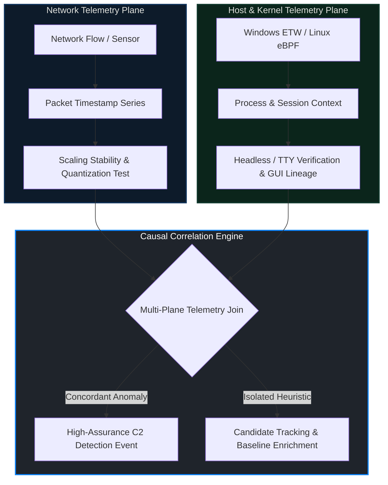

# The Evolution of Command-and-Control (C2) Traffic and NDR Blind Spots

### Advanced Blue Team Tactics Against Shaped Timing Dynamics

[](https://byghost.tr/)
[](https://github.com/ByGh00st)
[](https://doi.org/10.5281/zenodo.23141650)
[](./publications/ByGhost-C2-NDR-Technical-Report-EN-v1.0.pdf)
[](https://creativecommons.org/licenses/by-nc-nd/4.0/)

[](https://github.com/ByGh00st/c2-timing-ndr-blindspots/releases/tag/v1.0)
[](#finalized-publications-v10)

[Türkçe README](README_TR.md)

This is the primary repository for the ByGhost C2/NDR research publication. The full research article, mathematical discussion, architecture diagram, and defensive detection discussion remain below.

## Finalized Publications v1.0

The authoritative v1.0 editions are the two finalized PDFs below. Their contents are unchanged from the author's final source files. Use these files when downloading or citing the complete publication.

| Edition | Final publication | Document ID |
| --- | --- | --- |
| English | [Technical Report EN v1.0 (25 pages)](publications/ByGhost-C2-NDR-Technical-Report-EN-v1.0.pdf) | `SOC-NDR-MASTER-001-EN` |
| Turkish | [Technical Report TR v1.0 (33 pages)](publications/ByGhost-C2-NDR-Technical-Report-TR-v1.0.pdf) | `SOC-NDR-MASTER-001` |

Both editions contain the **T1-T20 defensive detection/correlation catalog** and are attached to the [v1.0 GitHub Release](https://github.com/ByGh00st/c2-timing-ndr-blindspots/releases/tag/v1.0).

### Zenodo / DOI

- **Version DOI:** [10.5281/zenodo.23141650](https://doi.org/10.5281/zenodo.23141650) identifies v1.0 specifically.
- **Concept DOI:** [10.5281/zenodo.23141649](https://doi.org/10.5281/zenodo.23141649) resolves to the latest Zenodo version.

### File Integrity

SHA-256 values were calculated from the finalized source files before copying and verified against both repository copies. Only the repository copy filenames were changed.

| Filename | SHA-256 |
| --- | --- |
| `ByGhost-C2-NDR-Technical-Report-EN-v1.0.pdf` | `96d8138312ca84f2cdfe905a64566aede2fdcc0de4d7a589dbdb8e471e27bc85` |
| `ByGhost-C2-NDR-Technical-Report-TR-v1.0.pdf` | `d1da8d191cdb5ff661a659c56aa13c7645bf5b2ce77af149c7b076d048ae4e2a` |

---

> **Author:** Oğulcan (ByGhost) Erarslan  
> **Title:** Senior Solutions Architect | Cyber Security Specialist  
> **Affiliation:** ByGhost Security  
> **Official Website:** [https://byghost.tr/](https://byghost.tr/)  
> **GitHub Profile:** [https://github.com/ByGh00st](https://github.com/ByGh00st)  
> **Contact / Profile:** [linkedin.com/in/byghost-tr](https://www.linkedin.com/in/byghost-tr)  
> **English Document ID:** `SOC-NDR-MASTER-001-EN`<br>
> **Turkish Document ID:** `SOC-NDR-MASTER-001`<br>
> **Publication Date:** October 2026  
> **License:** Creative Commons Attribution-NonCommercial-NoDerivatives 4.0 (CC BY-NC-ND 4.0)

> [!IMPORTANT]
> *This research publication, architectural blueprint, and associated detection engineering rules are licensed under the **Creative Commons Attribution-NonCommercial-NoDerivatives 4.0 International License (CC BY-NC-ND 4.0)**. No part of this publication or its derived telemetry logic may be used or reproduced without explicit author attribution; nor may it be integrated, directly or indirectly, into commercial cybersecurity products (EDR/NDR/XDR), managed services, or proprietary fee-based offerings without prior written authorization and an express commercial licensing agreement from the author. No derivative works or modifications are permitted. Document Identifier: `SOC-NDR-MASTER-001` / Author: Oğulcan Erarslan (ByGhost).*

---

## Repository Structure

This public repository contains the finalized research publications and their documentation.

```text
.
├── README.md
├── README_TR.md
├── CITATION.cff
├── LICENSE.md
├── CHANGELOG.md
├── .gitignore
└── publications/
    ├── ByGhost-C2-NDR-Technical-Report-EN-v1.0.pdf
    └── ByGhost-C2-NDR-Technical-Report-TR-v1.0.pdf
```

---

# Part I: Executive Research Article

## Abstract

A ubiquitous premise in adversarial emulation and defensive engineering asserts that injecting random delay—conventionally on the order of $\pm 20\%$ jitter—into Command-and-Control (C2) beacon intervals reliably bypasses Network Detection and Response (NDR) systems. This paper deconstructs the mathematical invalidity of that premise. We demonstrate that the apparent efficacy of jitter obfuscation stems from conflating two fundamentally distinct stochastic point processes: **Point-Event Time Jitter** and **Interval Jitter**. We prove that under point-event perturbation, consecutive inter-arrival times (IAT) share a common noise term, inducing an invariant lag-1 autocorrelation ($\rho_1 = -0.5$) and harmonic line scaling dictated by the characteristic function envelope ($\text{sinc}$). 

Furthermore, we trace the evolutionary shift toward **self-similar and Long-Range Dependent (LRD)** traffic shaping ($H > 0.5$), wherein C2 activity mimics aggregate enterprise background traffic. Under baseline-adapted conditions, classical flow-level discriminators—including marginal IAT distributions, Power Spectral Density (PSD), autocorrelation, scaling exponents, and diurnal profiling—suffer severe feature space degradation. In response, we formulate a fundamental paradigm shift from flow-level statistical heuristics to **causal and contextual telemetry correlation** (Windows ETW, Linux eBPF), providing an enterprise detection engineering blueprint that binds network flows to process execution lineage, user session state, and hardware timer mechanics.

---

## 1. The Jitter Fallacy: Why ~20% Random Jitter Fails as an Evasion Primitive

A widespread assumption across defensive and adversarial engineering asserts that adding random jitter—on the order of 20%—to beacon intervals reliably evades network detection systems. This assumption is structurally misleading: it conflates two fundamentally different stochastic point-process models and misdirects detection architecture design.

### 1.1 The Dichotomy of Two Distinct Jitter Models

In the first model, stochastic noise is injected directly into absolute event timestamps:
$$t_n = nT + \varepsilon_n$$

Because consecutive inter-arrival times (IAT) are derived from adjacent event times:
$$IAT_n = t_n - t_{n-1} = T + \varepsilon_n - \varepsilon_{n-1}$$

The resulting IAT sequence inherently exhibits shared noise terms and statistical dependency. Under the formal conditions that:
1. The noise sequence is identically and independently distributed (i.i.d.),
2. Possesses finite variance $\sigma_\varepsilon^2$, and
3. The event indices preserve physical chronological ordering,

This dependency assumes an invariant structure: the lag-1 covariance is $\text{Cov}(IAT_n, IAT_{n+1}) = -\sigma_\varepsilon^2$, and the variance is $\text{Var}(IAT_n) = 2\sigma_\varepsilon^2$. Consequently, the **lag-1 autocorrelation reaches an invariant**:
$$\rho_1 = \frac{-\sigma_\varepsilon^2}{2\sigma_\varepsilon^2} = -0.5$$

In scenarios where packet loss, transmission jitter, or transport-layer reordering disrupts chronological sequencing, this invariance cannot be guaranteed.

In the second model, stochastic perturbation is added directly to the interval duration itself:
$$IAT_n = T + U_n$$

Intervals are mutually independent, and absolute event times cumulatively form a renewal process:
$$t_n = \sum_{i=1}^n IAT_i$$

These two models yield fundamentally different marginal IAT distributions, dependency structures, and spectral profiles; detection logic must explicitly state which stochastic model is assumed.

```
Model A: Event-Time Jitter          Model B: Interval Jitter
(Shared Noise, rho_1 = -0.5)        (Renewal Process, rho_1 = 0)

   t_0     t_1     t_2                 t_0         t_1             t_2
    |-------|-------|                   |-----------|---------------|
    + eps_0 + eps_1 + eps_2                IAT_1=T+U_1     IAT_2=T+U_2
   IAT_1 = T + eps_1 - eps_0            Intervals independent & identically
   IAT_2 = T + eps_2 - eps_1            distributed; t_n = sum(IAT_i)
   Shared eps_1 term => rho_1 = -0.5
```

### 1.2 To Which Object Does the Spectrum Belong?

The discrete Fourier transform (DFT) of a constant, scalar IAT sequence produces exclusively a DC component ($f = 0$); discrete harmonic spectral lines originate from the continuous-time spectrum of the periodic point event train (the Dirac comb), not from the scalar IAT sequence itself. A detector that applies spectral analysis exclusively to scalar IAT arrays will structurally fail to detect even a rigid, fixed-period beacon.

The impact of jitter on this harmonic line structure is strictly model-dependent:
- Under the **event-time jitter model**, harmonic line amplitudes are scaled by the characteristic function (Fourier transform) of the jitter distribution, and harmonics coinciding with the zeros of this envelope are attenuated or suppressed entirely. In the case of uniform event-time jitter, the spectral envelope takes the unnormalized form:
  $$\Phi_\varepsilon(f) = \text{sinc}(2\pi p T f) = \frac{\sin(2\pi p T f)}{2\pi p T f}$$
- Under the **interval-jitter model**, a continuous interval distribution completely eliminates discrete line components for $f \neq 0$, transitioning the spectrum into a purely continuous density.

As observation duration and event sample sizes increase, the statistical power of spectral estimation scales according to the chosen windowing and tapering methodologies.

### 1.3 Bounded Support Context and Machine Learning Blind Spots

Observations of bounded interval support $[T_{\min}, T_{\max}]$ are likewise context-sensitive: legitimate enterprise applications, depending on protocol class and workload profile, exhibit substantially wider and highly diverse IAT supports; lower bounds are routinely imposed by protocol handshakes, transport buffering, thread schedulers, and timestamp clock resolution. Therefore, bounded support is not conclusive proof of malicious behavior, but merely a candidate feature.

Similarly, timing, spectral, and distributional summaries can be fed into machine learning-based anomaly detection models; however, the empirical performance of such models depends entirely on feature representation, training set diversity, and baseline stationarity. Asserting that any specific architecture will inherently succeed without empirical validation across real-world workloads is technically ungrounded.

> **Section Conclusion:** In the event-time jitter model, the harmonic line structure of a periodic event train degrades but does not vanish unconditionally; in the interval-jitter model, a continuous interval density eliminates discrete spectral lines for $f \neq 0$. Consequently, the evasion efficacy of jitter is strictly governed by the underlying stochastic model. Defensive detection frameworks must formulate hypotheses with explicitly defined stochastic assumptions.

---

## 2. The Evolution: Self-Similar Traffic and the Collapse of Flow-Level Discrimination

### 2.1 Self-Similarity and Long-Range Dependence (LRD)

Empirical self-similarity and Long-Range Dependence (LRD) have been widely documented across aggregated enterprise Ethernet, WAN backbones, and cloud egress fabrics; in these traces, the Hurst parameter consistently falls within the memory-retention regime ($H > 0.5$). Under temporal aggregation, memoryless Poisson processes flatten asymptotically into white noise, whereas LRD processes retain memory across multiple temporal scales.

This behavior cannot be attributed to a single cause: while heavy-tailed source distributions (such as Pareto-distributed file transfers) provide a primary mechanism, multi-scale multiplexing, application-layer request clustering, and network queueing artifacts also contribute.

### 2.2 Degradation of the Flow-Level Feature Space

When an adversary's C2 timing profile adapts to an enterprise baseline, cross-class discrimination within classical flow-level feature families—marginal IAT distributions, power spectral density, autocorrelation decay, scaling exponents, and diurnal rhythms—can diminish drastically.

```
       FLOW-LEVEL HEURISTICS                  CAUSAL & CONTEXTUAL TELEMETRY
┌───────────────────────────────────┐       ┌───────────────────────────────────┐
│ Marginal IAT Distribution         │       │ Process Execution Lineage         │
│ Power Spectral Density (PSD)      │  ==>  │ Controlling TTY / Window Context  │
│ Autocorrelation Decay             │       │ User Input Telemetry (WM_INPUT)   │
│ Hurst Parameter / Scaling (H)     │       │ ETW-TI / eBPF Kernel Callbacks    │
└───────────────────────────────────┘       └───────────────────────────────────┘
   (Collapses under Baseline Adaptation)      (Preserves High-Assurance Signal)
```

### 2.3 Non-Absence Theorem: Preserved Orthogonal Signals

This is not an information-theoretic claim of absolute absence: higher-order statistical dependencies, multifractal structure, protocol state consistency, cross-flow multi-host correlation, and host endpoint context retain discriminative capacity. The attenuation of flow-level separation does not mean that detection has become impossible; it dictates that detection efforts must migrate to orthogonal feature families.

---

## 3. The Paradigm Shift: Contextual and Causal Detection Engineering

### 3.1 Candidate Detection Features Across Degraded Baselines

Human-interactive workloads and automated processes exhibit distinct temporal and contextual variability patterns; however, this distinction is not absolute and requires workload-specific baselines. When discrimination collapses within flow-level statistics, defensive value concentrates across the following orthogonal candidate features:

- **Scaling Stability:** The moving-window variance of scaling exponents ($H$) and tail index estimates evaluated against segment baselines; anomalous parameter stability serves as a candidate anomaly signal requiring multi-plane correlation.
- **Tail Structure:** Systematic deviations in the empirical upper tail relative to the segment baseline, diagnosed through tail-index estimators (e.g., Hill estimator) and complementary cumulative distribution function (CCDF) plots.
- **Timer Quantization & Continuous Sampling:** Clustering artifacts induced by operating system thread schedulers, runtime sleep APIs, power management policies, and hardware timestamp clock sources. Conversely, evaluating whether continuous float-domain sampling ($T = -\ln(U)/\lambda$) has been introduced to break discrete timer buckets.
- **Fleet-Wide Similarity:** Unusually uniform timing or scaling parameters observed across disparate endpoints within an enterprise fleet, providing an actionable candidate signal for fleet-wide correlation.
- **Endpoint Causal Context & Human Presence (T8, T19):** Flow-to-process binding, user session boundaries, interactive versus non-interactive process execution states, parent process lineage, service/task contexts, and correlated user hardware input telemetry (`GetLastInputInfo`, `WM_INPUT`, `/dev/input`). Auditing whether unprompted network bursts occur during deep workstation idle or screen-lock states.
- **Subsystem TLS Stack Consistency (T10, T20):** Verifying that processes generating port 443 HTTPS traffic legitimately load operating system TLS libraries (`winhttp.dll`, `schannel.dll`) and register corresponding ETW provider events, rather than establishing raw socket flows with disparate JA4 fingerprints.
- **Hardware Bus & Out-of-Band Boundaries (T16–T18):** Telemetry auditing across storage diagnostic pass-through routines (SCSI CDB `0x1D`), IOMMU coherent DMA buffers, and hardware performance counters (PMU memory serialization barriers) to intercept non-network covert physical communication channels.
- **Process Execution Behavior:** Repetitive or quantized execution cycles observed in process runtime behavior, evaluated against workload-specific baselines as a candidate correlation signal.

### 3.2 Multi-Planar Causal Correlation Architecture

High-assurance detection decisions are reached through the intersection of independent telemetry planes:



### 3.3 Operational Takeaway: Redefining the Detection Question

When the discriminative power of flow-level network statistics diminishes, detection engineering shifts to the causality plane: the obsolete inquiry *"Does this network traffic appear human-like?"* is superseded by the causal question:

> **"Is the host process and session context generating this network flow consistent with the claimed user and workload identity?"**

---

### Public-Release Scope Notice & Responsible Disclosure

This work does not disclose proprietary command-and-control implementation architectures or operational weaponization details. All examples and models are generalized exclusively to advance defensive engineering, telemetry measurement, and detection validation.

---

**Oğulcan (ByGhost) Erarslan**  
Senior Solutions Architect | Cyber Security Specialist  
ByGhost Security · [https://byghost.tr/](https://byghost.tr/) · [https://github.com/ByGh00st](https://github.com/ByGh00st) · [linkedin.com/in/byghost-tr](https://www.linkedin.com/in/byghost-tr)  

---

# Part II: Defensive Detection Engineering

The finalized PDFs contain the T1-T20 defensive detection and correlation catalog, including Sigma, KQL, SPL, ETW, and eBPF-oriented research examples. Read these examples with their stated assumptions, telemetry requirements, baseline calibration, false-positive considerations, and validation limits.

The publication connects timing measurements to process lineage, session state, identity, and endpoint context. Candidate signals require workload-specific calibration and detector validation before use in a production environment. The PDFs remain the authoritative technical source.

## License

The publication material is distributed under [Creative Commons Attribution-NonCommercial-NoDerivatives 4.0 International (CC BY-NC-ND 4.0)](https://creativecommons.org/licenses/by-nc-nd/4.0/), unless explicitly stated otherwise. See [LICENSE.md](LICENSE.md) for the license notice and legal-text link.

---

## References & Citation

If you reference this research, derive telemetry models from it, or incorporate its findings into detection rules, please cite this work as follows:

Erarslan, Oğulcan (ByGhost). (2026). *The Evolution of Command-and-Control (C2) Traffic and NDR Blind Spots: Advanced Blue Team Tactics Against Shaped Timing Dynamics*. Version 1.0. ByGhost Security. Zenodo. [https://doi.org/10.5281/zenodo.23141650](https://doi.org/10.5281/zenodo.23141650).

### BibTeX
```bibtex
@techreport{erarslan2026c2ndr,
  author      = {Erarslan, Oğulcan},
  title       = {The Evolution of Command-and-Control (C2) Traffic and NDR Blind Spots: Advanced Blue Team Tactics Against Shaped Timing Dynamics},
  institution = {ByGhost Security},
  year        = {2026},
  type        = {Research report},
  note        = {Version 1.0. Archived on Zenodo},
  doi         = {10.5281/zenodo.23141650},
  url         = {https://doi.org/10.5281/zenodo.23141650}
}
```

### Citation File Format (CFF)
Refer to [`CITATION.cff`](./CITATION.cff) included within this repository for machine-readable citation metadata.

---

**ByGhost Security** · *Sovereign Systems & Defense-Grade Cyber Security Architecture*  
*Official Website: [https://byghost.tr/](https://byghost.tr/) · GitHub: [https://github.com/ByGh00st](https://github.com/ByGh00st) · Inquiries: [linkedin.com/in/byghost-tr](https://www.linkedin.com/in/byghost-tr)*
